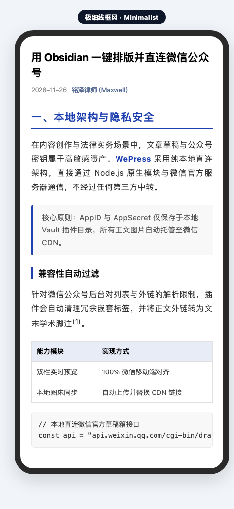
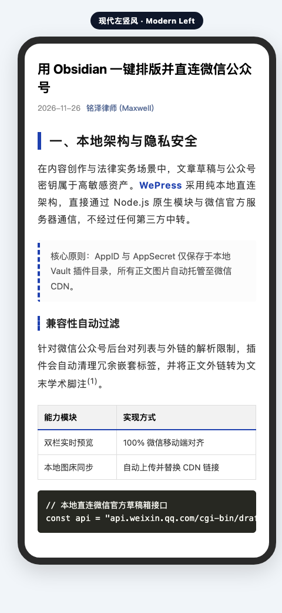
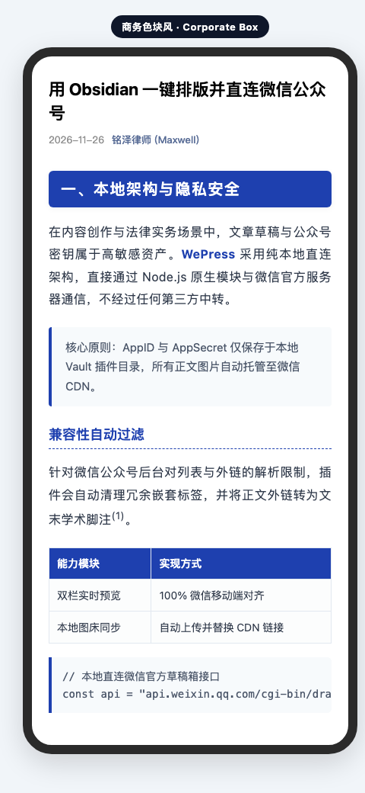
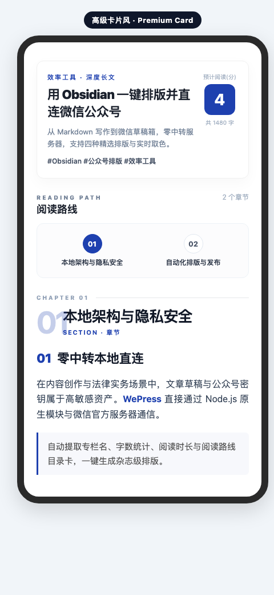
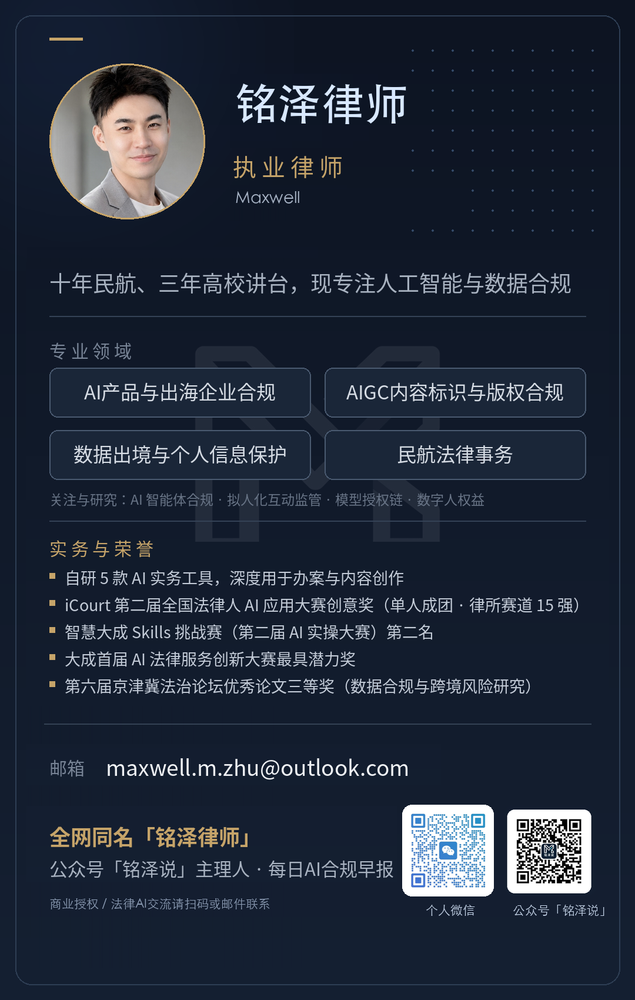

<div align="center">


# WePress

> 原 **Obsidian WeChat Publisher** —— 面向自媒体创作者与法律人的本地一键微信排版与草稿箱直连同步插件。

[简体中文](README.md) | [English](README_EN.md)

</div>

WePress 是一个用于将 Obsidian 本地 Markdown 笔记一键渲染并无缝同步至微信公众号草稿箱的开源插件。本插件采用完全本地化的架构设计，无需中转服务器，直接保障自媒体创作者的数据与账号安全。

---

<h2 align="center">📷 功能效果预览 (Screenshots)</h2>

<div align="center">
  
</div>

<h3 align="center">🎨 四套内置排版风格对比 (Layout Styles)</h3>

<div align="center">
  
  &nbsp;&nbsp;&nbsp;&nbsp;
  
  <br>
  <b>左上：极细线框风 (Minimalist)</b> &nbsp;&nbsp;|&nbsp;&nbsp; <b>右上：现代左竖风 (Modern Left)</b>
  <br><br>
  
  &nbsp;&nbsp;&nbsp;&nbsp;
  
  <br>
  <b>左下：商务色块风 (Corporate Box)</b> &nbsp;&nbsp;|&nbsp;&nbsp; <b>右下：高级卡片风 (Premium Card)</b>
</div>


---

<h2 align="center">🔑 隐私安全说明 (Security & Privacy)</h2>

本插件经过严格的安全审计，保障您的数据隐私：
1. **零密钥泄露**：敏感的 AppID 与 AppSecret 仅存储于您本地 Vault 插件文件夹下的 `data.json` 中，绝不上传。
2. **纯本地直连**：插件通过 Node.js 原生底层 `https` 模块，直接与微信官方服务器（`api.weixin.qq.com`）通信，无任何第三方服务器中转。
3. **开源透明**：所有核心逻辑开源可见，没有任何混淆加密。

---

<h2 align="center">✨ 核心优势与功能 (Key Features & Advantages)</h2>

*   **开发者署名与非商用开源协议**：由 **铭泽律师 (Maxwell)** 专为法律人与自媒体创作者开发，个人与公益场景完全免费使用；**严禁任何形式的商业售卖、付费打包或未授权商业集成**。如需商业使用或企业级授权，**必须联系作者购买付费商业授权并取得书面许可**（邮箱：`maxwell.m.zhu@outlook.com`，详见 [LICENSE](LICENSE)）。二次分发与修改须保留原作者署名。
*   **双栏实时预览 (Live Preview Simulator)**：可在 Obsidian 内部一键开启与微信移动端 100% 像素级对齐的预览模拟器。编辑正文时，预览窗口支持实时同步渲染，彻底告别在第三方编辑器之间反复复制粘贴的繁琐流程。
*   **四套精选版式与个性取色 (Custom Theme & Preset Layouts)**：内置「极细线框风」、「现代左竖风」、「商务色块风」与「高级卡片风」（支持文章信息前置大卡片、阅读路线章节目录卡、CHAPTER 大字编号、末尾互动尾图），支持在预览控制栏中通过 Hex 取色器实时修改主色调，并支持字号与行距动态调节。更多版本演进详见 [更新日志](CHANGELOG.md)。
*   **微信排版兼容性过滤器 (WeChat Layout Filter)**：
    *   **列表深度容错**：自动剥除 `<li>` 标签内部嵌套的 `<p>` 段落标签，消除微信公众号后台解析列表时常出现的双重序号、多余空白行等顽固格式 Bug。
    *   **表格与代码块美化**：自动将 Markdown 渲染的复杂表格和代码块转化为符合微信严格行内规则的行内 CSS 样式。代码块支持自动溢出滚动，表格支持细边框防错位，保障代码和数据展示的易读性。
*   **外链自动转文末脚注 (External Link Footnotes)**：针对微信公众号正文屏蔽外部超链接的痛点，自动解析正文中的外链并生成规范角标（如 `链接 ⁽¹⁾`），同时在文章末尾自动追加 `💡 延伸参考与链接` 部分，维护极佳的学术深度与专业阅读质感。
*   **本地媒体自动托管与上传进度 (Local Image CDN Hosting)**：一键识别 Obsidian 专属 `![[image.png]]` 和各类本地相对图片路径。在同步时自动将本地插图与 YAML frontmatter 中通过 `cover` 字段指定的封面图上传至微信服务器进行 CDN 托管，并全程提供 `[图片 i/N]` 同步进度条气泡反馈。

---

<h2 align="center">🛠️ 安装方法 (Installation)</h2>

### 手动安装 (Manual Installation)
1. 前往本仓库 [Releases](https://github.com/Maxwell-zhu214/WePress/releases) 下载最新版的 `main.js` 与 `manifest.json` 文件。
2. 打开您的 Obsidian 库根目录，进入隐藏文件夹 `.obsidian/plugins/`。
3. 新建名为 `wepress` 的子文件夹（若此前使用旧版 `obsidian-wechat-publisher`，可直接将该文件夹重命名为 `wepress` 并覆盖文件）。
4. 将 `main.js` 和 `manifest.json` 放入 `.obsidian/plugins/wepress/` 目录中。
5. 打开 Obsidian「设置」→「第三方插件」，关闭安全模式后刷新列表，开启 **WePress** 即可。

---

<h2 align="center">📖 使用教程 (Usage Guide)</h2>

### 第一步：配置微信公众号凭证
1. 登录 [微信公众平台](https://mp.weixin.qq.com/)，进入左侧菜单「设置与开发」→「基本配置」，获取您的 **AppID** 与 **AppSecret**。
2. 在同一页面的「IP 白名单」中，将您当前电脑的公网 IP 地址加入白名单（否则微信服务器会拦截本地同步请求）。
3. 回到 Obsidian，打开「设置」→「第三方插件」→「**WePress**」，填入 `AppID`、`AppSecret`、默认作者名，并选择您喜欢的默认排版版式与主题色。

### 第二步：（可选）在笔记顶部添加 Frontmatter 元数据
在您的 Markdown 笔记最顶部，可以通过 YAML Frontmatter 指定封面图、专栏名、摘要与标签（不填也会自动适配）：

```yaml
---
title: 文章主标题
author: 铭泽律师
cover: assets/cover.png
column_name: 深度长文
digest: 一句话文章导读摘要
tags:
  - AI合规
  - 效率工具
---
```

> 💡 **提示**：若未在 Frontmatter 中指定 `cover`，插件会自动将正文中第一张图片（或标注为 `` 的图片）作为公众号封面上传。

### 第三步：实时预览与一键同步到草稿箱
1. 在 Obsidian 中打开您要发布的 Markdown 笔记。
2. 按下 `Cmd + P`（Windows 为 `Ctrl + P`）呼出命令面板：
   * 运行 **`WePress: 预览当前笔记的微信排版效果`**：右侧将打开 1:1 微信移动端模拟器。您可以在顶部控制栏实时切换 4 套排版风格、使用取色器修改主色调、调整字号与行距。
   * 确认效果无误后，点击预览栏右上角的 **`📡 同步到草稿箱`** 按钮（或直接在命令面板运行 **`WePress: 同步当前笔记到微信公众号草稿箱`**）。
3. 插件会自动将本地图片上传至微信 CDN 并生成排版后的图文草稿，几秒后即可在微信公众号后台「草稿箱」中看到成稿。

---

<h2 align="center">💬 联系与交流 (Contact)</h2>

<p align="center">如果您在使用过程中遇到任何问题，或者希望交流法律 AI、自媒体创作以及数字化效率工具，欢迎关注我的微信公众号或添加我的个人微信。</p>

<div align="center">
  
  &nbsp;&nbsp;&nbsp;&nbsp;&nbsp;&nbsp;&nbsp;&nbsp;
  
  <br>
  <b>左：微信公众号「铭泽说Mingtalk」</b> &nbsp;&nbsp;|&nbsp;&nbsp; <b>右：个人微信「铭泽律师」</b>
</div>

<p align="center"><b>商业授权联系邮箱</b>：<code>maxwell.m.zhu@outlook.com</code></p>

---

<h2 align="center">👨‍💼 关于作者 (About the Author)</h2>

<div align="center">
  
</div>
