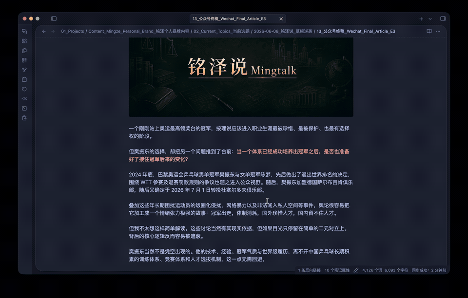

<div align="center">


# WePress

> Formerly **Obsidian WeChat Publisher** — A local one-click WeChat formatting and draft box synchronization plugin for creators and legal professionals.

[English](README_EN.md) | [简体中文](README.md)

</div>

WePress is an open-source Obsidian plugin designed to format and seamlessly sync local Markdown notes to your WeChat Official Account drafts box with one click. Adopting a fully localized architecture, it runs entirely on your machine without intermediate proxy servers, ensuring maximum data confidentiality and account safety.

---

<h2 align="center">📷 Demo & Screenshots</h2>

<div align="center">
  <br>
  <sub>🎬 Live Demo (2.8x speed): Open live preview → Switch layout styles & typography → One-click sync to WeChat Drafts</sub>
</div>

<h3 align="center">🎨 Built-in Layout Styles</h3>

<div align="center">
  
  &nbsp;&nbsp;&nbsp;&nbsp;
  
  <br>
  <b>Top Left: Minimalist (极细线框风)</b> &nbsp;&nbsp;|&nbsp;&nbsp; <b>Top Right: Modern Left (现代左竖风)</b>
  <br><br>
  
  &nbsp;&nbsp;&nbsp;&nbsp;
  
  <br>
  <b>Bottom Left: Corporate Box (商务色块风)</b> &nbsp;&nbsp;|&nbsp;&nbsp; <b>Bottom Right: Premium Card (高级卡片风)</b>
</div>


---

<h2 align="center">🔑 Security & Privacy Audit</h2>

This plugin undergoes rigorous security checks to guarantee your privacy:
1. **Zero Secret Leakage**: Your sensitive AppID and AppSecret credentials are stored purely inside the `data.json` configuration file within your local Obsidian Vault plugin folder.
2. **Direct Connection**: Using the Node.js native `https` module, the plugin communicates directly with the official WeChat server (`api.weixin.qq.com`). No third-party proxy or relay servers are involved.
3. **Open Source & Auditable**: The core logic is fully transparent and open-source, allowing peer security reviews.

---

<h2 align="center">✨ Key Features & Advantages</h2>

*   **Non-Commercial Open Source & Paid Commercial Licensing**: Developed by **铭泽律师 (Maxwell)** for legal professionals and creators. Free for personal, research, and non-profit use; **commercial sale, paid bundling, or unauthorized commercial use is strictly prohibited**. Any commercial use requires **contacting the author (`maxwell.m.zhu@outlook.com`) for a paid commercial license and prior written authorization** (see [LICENSE](LICENSE)). Original author attribution must be retained.
*   **Side-by-Side Live Preview**: Open an interactive mobile simulator inside Obsidian that aligns 100% with the WeChat layout. Visual rendering updates instantly as you edit, saving you from repetitive copy-pasting.
*   **Four Curated Layout Presets**: Built-in "Minimalist", "Modern Left", "Corporate Box", and "Premium Card" (featuring a top article info card, Reading Path TOC, chapter numbering, and call-to-action footer). Customize the primary color with an integrated Hex color picker, plus dynamic font size and line-height controls. See [CHANGELOG.md](CHANGELOG.md) for version history.
*   **WeChat Layout Compatibility Filters**:
    *   **List Bug Fixes**: Automatically purges nested `<p>` tags inside `<li>` elements, fixing double-bullet and empty-row errors commonly caused by WeChat's parser.
    *   **Tables & Code Blocks**: Automatically translates Markdown tables and code blocks into WeChat-friendly inline CSS styles. Supports code overflow scrolling and border alignments.
*   **Automated Link-to-Footnote Conversion**: WeChat restricts external hyperlinks inside article bodies. The plugin automatically converts external links into superscript footnotes (e.g. `Link ⁽¹⁾`) and appends a clean `💡 Reference Links` index section at the bottom.
*   **Local Image CDN Upload**: Automatically uploads local relative images and YAML frontmatter-specified `cover` images directly to WeChat CDN, resolving image loading blocking issues. Shows real-time progress indicators (e.g. `[Image i/N] Syncing...`).

---

<h2 align="center">🛠️ Installation Guide</h2>

### Manual Installation
1. Download `main.js` and `manifest.json` from the latest [Releases](https://github.com/Maxwell-zhu214/WePress/releases).
2. Open your Obsidian Vault directory and navigate to the hidden folder `.obsidian/plugins/`.
3. Create a folder named `wepress` (if upgrading from `obsidian-wechat-publisher`, rename that folder to `wepress` and overwrite the files).
4. Copy `main.js` and `manifest.json` into `.obsidian/plugins/wepress/`.
5. Open Obsidian **Settings → Community plugins**, refresh the list, and enable **WePress**.

---

<h2 align="center">📖 Usage Guide</h2>

### Step 1: Configure WeChat Official Account Credentials
1. Log in to the [WeChat Official Account Platform](https://mp.weixin.qq.com/), go to **Settings & Development → Basic Configuration**, and copy your **AppID** and **AppSecret**.
2. Add your computer's public IP address to the **IP Whitelist** on the same page (required by WeChat's API).
3. In Obsidian, go to **Settings → Community plugins → WePress**, enter your `AppID`, `AppSecret`, default author name, and choose your preferred layout style and theme color.

### Step 2: (Optional) Add YAML Frontmatter to Your Note
You can specify the cover image, column name, digest, and tags at the top of your Markdown note:

```yaml
---
title: Your Article Title
author: Maxwell
cover: assets/cover.png
column_name: Deep Dive
digest: A short summary of your article
tags:
  - Productivity
  - Obsidian
---
```

> 💡 **Tip**: If `cover` is omitted, WePress automatically uses the first image in your note (or an image with `alt="封面"`) as the draft cover.

### Step 3: Live Preview & One-Click Sync
1. Open the Markdown note you want to publish in Obsidian.
2. Press `Cmd + P` (or `Ctrl + P` on Windows) to open the Command Palette:
   * Run **`WePress: 预览当前笔记的微信排版效果`** to open the side-by-side mobile simulator. Switch between the 4 layout styles, pick a custom primary color, and adjust font size or line height in real time.
   * When ready, click **`📡 同步到草稿箱`** in the preview toolbar (or run **`WePress: 同步当前笔记到微信公众号草稿箱`** directly).
3. WePress will upload all local images to WeChat CDN and push the formatted article straight into your Official Account Drafts Box.

---

<h2 align="center">💬 Contact & Collaboration</h2>

<p align="center">If you encounter any issues or wish to discuss legal AI, self-media creation, or digital efficiency tools, feel free to follow my WeChat Official Account or add me on WeChat.</p>

<div align="center">
  
  &nbsp;&nbsp;&nbsp;&nbsp;&nbsp;&nbsp;&nbsp;&nbsp;
  
  <br>
  <b>Left: WeChat Account (Mingtalk)</b> &nbsp;&nbsp;|&nbsp;&nbsp; <b>Right: Personal WeChat (Maxwell)</b>
</div>

<p align="center"><b>Commercial Licensing Email</b>: <code>maxwell.m.zhu@outlook.com</code></p>

---

<h2 align="center">👨‍💼 About the Author</h2>

<div align="center">
  
</div>
