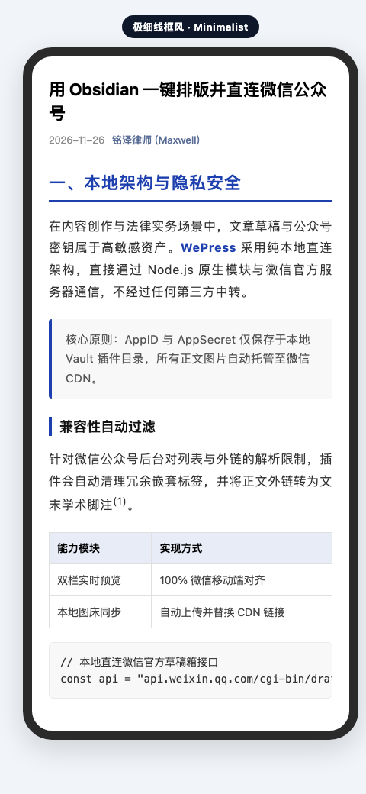
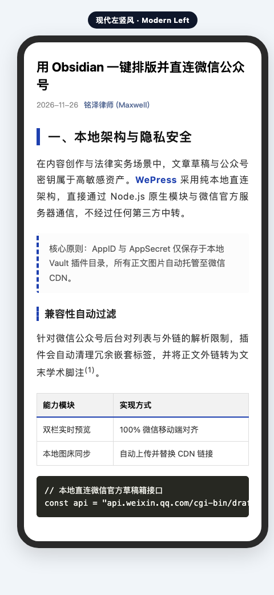
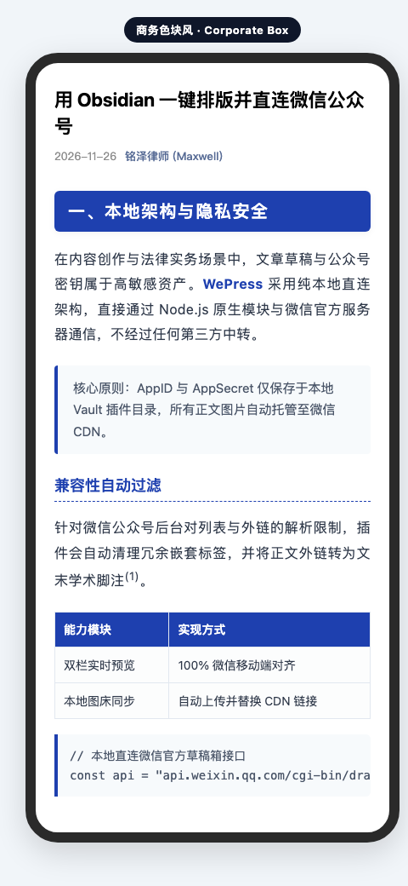
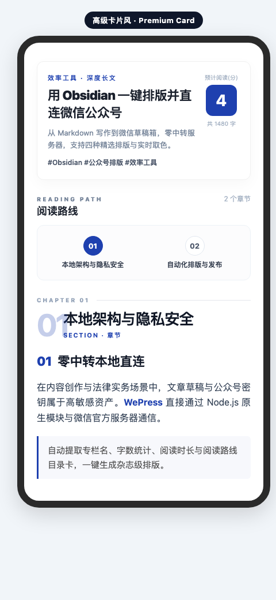
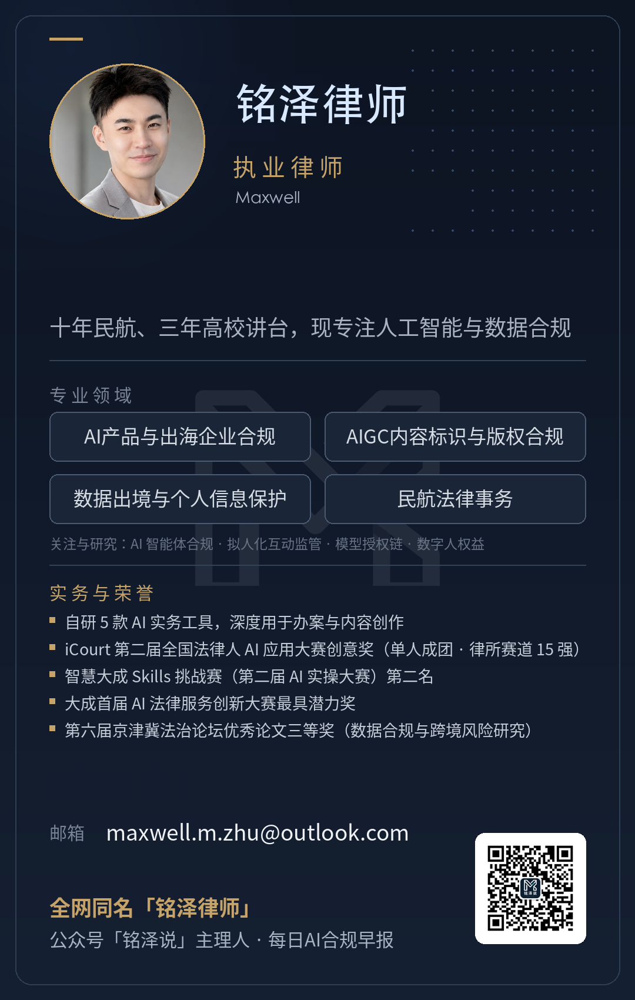

# WePress

> Formerly **Obsidian WeChat Publisher** — A local one-click WeChat formatting and draft box synchronization plugin for creators and legal professionals.

[English](README_EN.md) | [简体中文](README.md)

WePress is an open-source Obsidian plugin designed to format and seamlessly sync local Markdown notes to your WeChat Official Account drafts box with one click. Adopting a fully localized architecture, it runs entirely on your machine without intermediate proxy servers, ensuring maximum data confidentiality and account safety.

---

<h2 align="center">👨‍💼 About the Author</h2>

  

---

<h2 align="center">📷 Screenshots</h2>

### 🎨 Built-in Layout Styles

| Minimalist (极细线框风) | Modern Left (现代左竖风) |
| :---: | :---: |
|  |  |

| Corporate Box (商务色块风) | Premium Card (高级卡片风) |
| :---: | :---: |
|  |  |

---

<h2 align="center">🔑 Security & Privacy Audit</h2>

This plugin undergoes rigorous security checks to guarantee your privacy:
1. **Zero Secret Leakage**: Your sensitive AppID and AppSecret credentials are stored purely inside the `data.json` configuration file within your local Obsidian Vault plugin folder.
2. **Direct Connection**: Using the Node.js native `https` module, the plugin communicates directly with the official WeChat server (`api.weixin.qq.com`). No third-party proxy or relay servers are involved.
3. **Open Source & Auditable**: The core logic is fully transparent and open-source, allowing peer security reviews.

---

<h2 align="center">✨ Key Features & Advantages</h2>

*   **Non-Commercial Open Source & Paid Commercial Licensing**: Developed by **铭泽律师 (Maxwell)** for legal professionals and creators. Free for personal, research, and non-profit use; **commercial sale, paid bundling, or unauthorized commercial use is strictly prohibited**. Any commercial use requires **contacting the author (`maxwell.m.zhu@outlook.com`) for a paid commercial license and prior written authorization** (see [LICENSE](LICENSE)). Original author attribution must be retained.
*   **Side-by-Side Live Preview**: Open an interactive mobile simulator inside Obsidian that aligns 100% with the WeChat layout. Visual rendering updates instantly as you edit, saving you from repetitive copy-pasting.
*   **Four Curated Layout Presets**: Built-in "Minimalist", "Modern Left", "Corporate Box", and "Premium Card" (featuring a top article info card, Reading Path TOC, chapter numbering, and call-to-action footer). Customize the primary color with an integrated Hex color picker, plus dynamic font size and line-height controls. See [CHANGELOG.md](CHANGELOG.md) for version history.
*   **WeChat Layout Compatibility Filters**:
    *   **List Bug Fixes**: Automatically purges nested `
` tags inside `<li>` elements, fixing double-bullet and empty-row errors commonly caused by WeChat's parser.
    *   **Tables & Code Blocks**: Automatically translates Markdown tables and code blocks into WeChat-friendly inline CSS styles. Supports code overflow scrolling and border alignments.
*   **Automated Link-to-Footnote Conversion**: WeChat restricts external hyperlinks inside article bodies. The plugin automatically converts external links into superscript footnotes (e.g. `Link ⁽¹⁾`) and appends a clean `💡 Reference Links` index section at the bottom.
*   **Local Image CDN Upload**: Automatically uploads local relative images and YAML frontmatter-specified `cover` images directly to WeChat CDN, resolving image loading blocking issues. Shows real-time progress indicators (e.g. `[Image i/N] Syncing...`).

---

<h2 align="center">🛠️ Installation Guide</h2>

### Manual Installation
1. Download `main.js` and `manifest.json` from the latest repository files.
2. Open your Obsidian Vault directory and navigate to the hidden directory `.obsidian/plugins/`.
3. Create a folder named `obsidian-wechat-publisher`.
4. Copy `main.js` and `manifest.json` into that folder.
5. Open Obsidian settings, go to "Community Plugins", and enable **WeChat Publisher**.

---

<h2 align="center">💬 Contact & Collaboration</h2>

If you encounter any issues or wish to discuss legal AI, self-media creation, or digital efficiency tools, feel free to follow my WeChat Official Account or add me on WeChat.

| WeChat Official Account | Personal WeChat |
| :---: | :---: |
|    **WeChat Account: Mingtalk** |    **Personal WeChat: Maxwell** |

*   **Commercial Licensing Email**: `maxwell.m.zhu@outlook.com`

---

  

